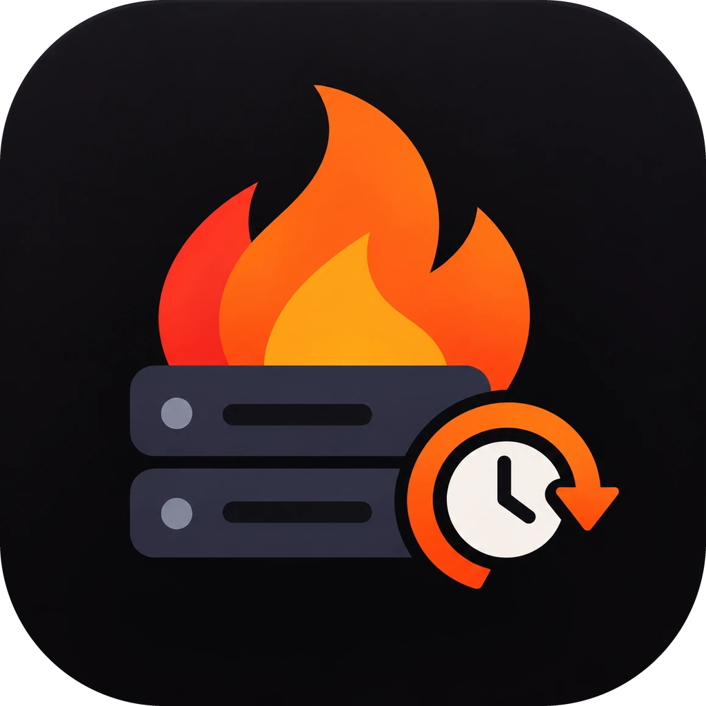
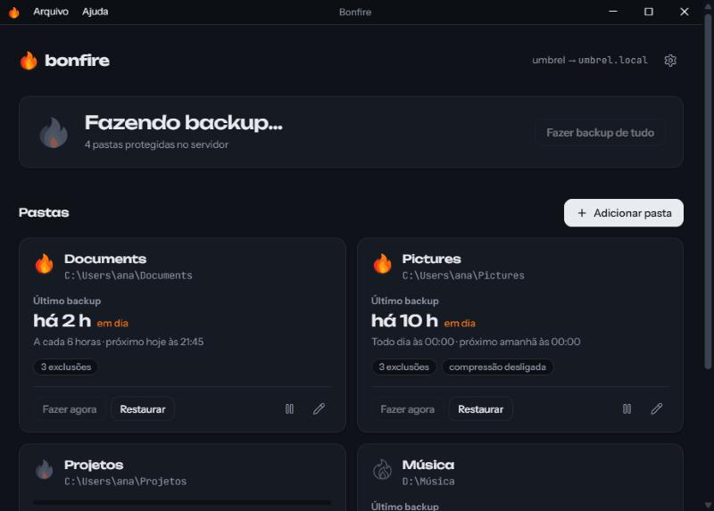
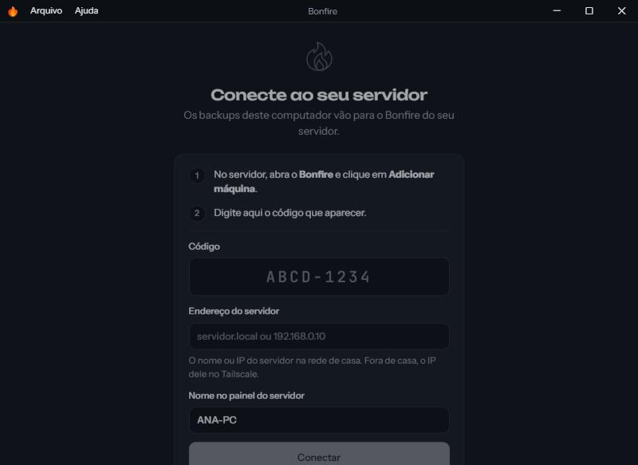
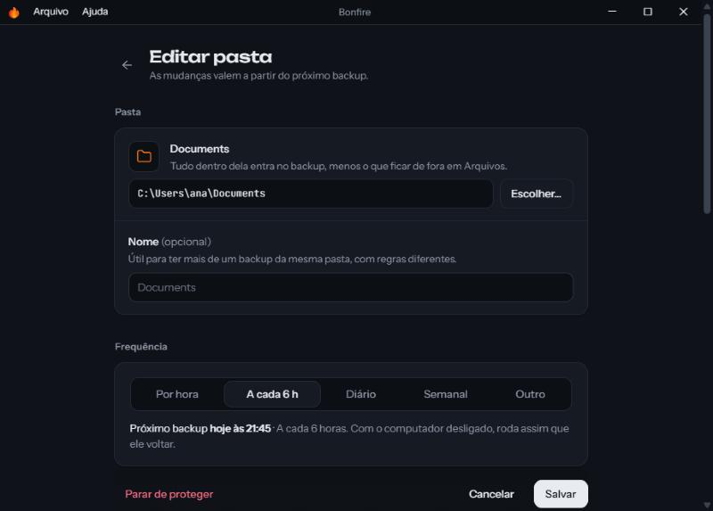
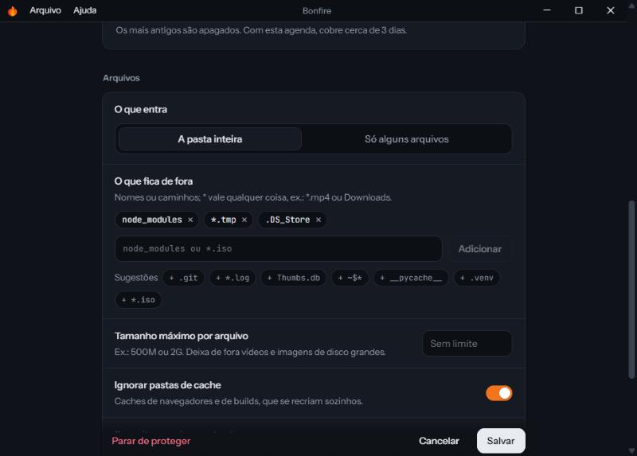
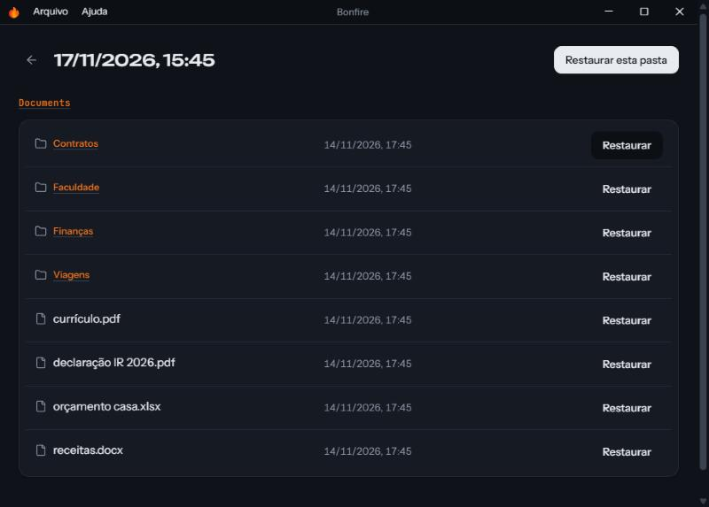
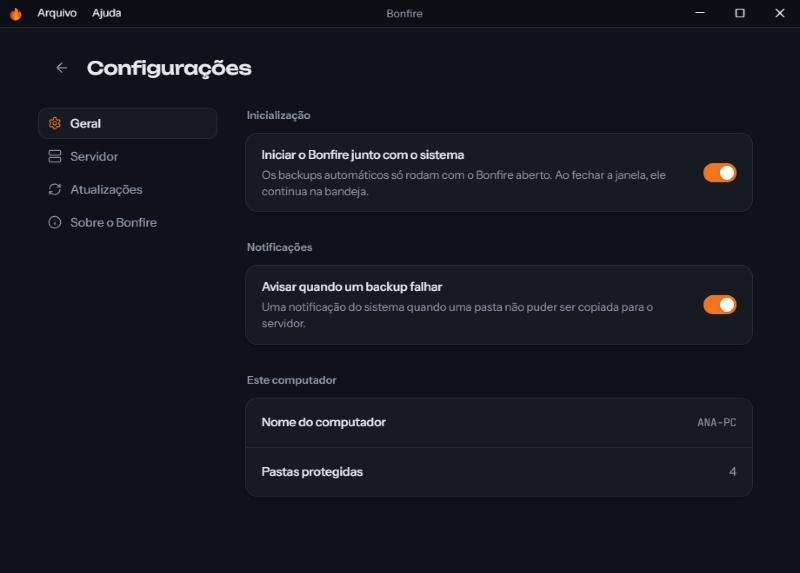

<p align="center">
  
</p>

<h1 align="center">Bonfire Desktop</h1>

<p align="center">
  <a href="https://github.com/danillo-ao/bonfire-releases/releases/latest"></a>
  <a href="https://github.com/danillo-ao/bonfire-releases/releases/latest"></a>
  <a href="https://github.com/danillo-ao/bonfire-releases/releases"></a>
  
  
</p>

<p align="center"><strong>Mantenha seus arquivos aquecidos e seguros.</strong></p>

O Bonfire faz backups automáticos das pastas do seu computador para o **seu Umbrel**, sem conta, nuvem nem assinatura. Cada backup é **criptografado e sem duplicação**: só o que mudou é enviado. O motor por trás é o [restic](https://restic.net), que já vem embutido no app.

Este repositório só guarda os instaladores do app desktop. O servidor é o app **Bonfire** da loja do Umbrel.



## Download

Baixe a versão mais recente na [página de Releases](../../releases/latest).

| Sistema | Arquivo |
| --- | --- |
| Windows 10/11 (64 bits) | `Bonfire_<versão>_x64-setup.exe` (ou `.msi`) |
| macOS (Apple Silicon: M1, M2…) | `Bonfire_<versão>_aarch64.dmg` |
| macOS (Intel) | `Bonfire_<versão>_x64.dmg` |

Os outros arquivos (`.app.tar.gz`, `.sig` e `latest.json`) são usados pelo atualizador do app. Não é preciso baixá-los.

> Uma versão pode sair primeiro para um sistema e depois para o outro. Se o arquivo do seu sistema ainda não estiver lá, use a versão anterior por enquanto.

## Primeiros passos

1. **Instale o Bonfire no Umbrel**, pela loja de apps.
2. **Instale o app desktop** neste computador (veja [Observações por sistema](#observações-por-sistema)).
3. **Gere um código.** No painel do Bonfire no Umbrel, clique em **Adicionar máquina**. O código vale por 10 minutos e só uma vez.
4. **Conecte.** No app desktop, digite o código e o endereço do Umbrel (`umbrel.local` ou o IP dele na rede de casa).

   

5. **Escolha as pastas.** Em **Adicionar pasta**, escolha a pasta e com que frequência guardar uma cópia. O primeiro backup começa em seguida.

## Recursos

### Pastas e agenda

Cada pasta protegida vira um cartão com o último backup, o próximo horário e o estado da brasa. **Fazer agora** roda um backup na hora; **Fazer backup de tudo** roda todas as pastas.

- Frequência **por hora**, **a cada 6 h**, **diária**, **semanal** ou um intervalo próprio (minutos, horas, dias ou semanas).
- **Horários fixos**: comece num horário marcado e escolha os dias (dias úteis, fim de semana ou dias avulsos).
- Se o computador estava desligado ou dormindo no horário, o backup roda assim que ele voltar.
- Pause uma pasta sem perder a configuração.
- A mesma pasta pode ter mais de um backup, com regras diferentes. Dê um **nome** para diferenciar.



### O que a brasa quer dizer

| Brasa | Significa |
| --- | --- |
| Acesa | **em dia**: o último backup está dentro do intervalo |
| Morna | **atrasado**: passou do intervalo |
| Fria | **parado**: mais de três intervalos sem backup |
| Cinza | **sem backup**: a pasta ainda não tem nenhum |

### O que entra no backup

- **A pasta inteira** ou **só alguns arquivos** (por exemplo `*.pdf`, `*.docx`, `*.jpg`).
- **O que fica de fora**: nomes ou caminhos, com `*` valendo qualquer coisa. Há sugestões prontas como `node_modules`, `.git`, `*.tmp` e `Thumbs.db`.
- **Tamanho máximo por arquivo**, para deixar de fora vídeos e imagens de disco grandes.
- **Ignorar pastas de cache** de navegadores e de builds.
- **Compressão** equilibrada, máxima ou desligada (boa para fotos e vídeos, que já vêm comprimidos).
- **Limitar velocidade de envio**, para deixar a internet livre para o resto da casa.



### Histórico

Defina quantos backups guardar por pasta. Os mais antigos são apagados pelo próprio Umbrel, e o app mostra quanto tempo de histórico isso cobre com a agenda escolhida.

### Restaurar

Em **Restaurar**, escolha de qual momento recuperar, navegue pelas pastas daquele backup e restaure um arquivo, uma subpasta ou **a pasta inteira** para onde quiser. A estrutura de pastas original é mantida.



### Em segundo plano

- **Inicia junto com o sistema** e segue rodando na bandeja (Windows) ou na barra de menus (macOS) quando você fecha a janela.
- **Notificação** do sistema quando um backup falha, com a explicação em português e o erro original em **Detalhes**.



## Observações por sistema

Os builds não são assinados, então o sistema avisa na primeira vez que o app abre.

### Windows

1. Execute o instalador `-setup.exe` (ou o `.msi`).
2. Se o SmartScreen avisar "O Windows protegeu o computador", clique em **Mais informações › Executar assim mesmo**.

### macOS

1. Abra o `.dmg` e arraste o **Bonfire** para **Aplicativos**.
2. Rode no Terminal:

   ```bash
   xattr -dr com.apple.quarantine /Applications/Bonfire.app
   ```

   Sem esse comando, o macOS diz que o app "está danificado".

Isso só é preciso na primeira instalação. As atualizações seguintes abrem normalmente.

## Fora de casa

O Bonfire não fica exposto à internet. Para fazer backup longe da rede de casa, instale o app **Tailscale** no Umbrel e no computador e use o IP do Umbrel no Tailscale como endereço do servidor. Sem conexão, o Bonfire tenta de novo sozinho.

## Atualização

O Bonfire procura novas versões neste repositório uma vez por dia (dá para desligar em **Configurações › Atualizações**) ou quando você clica em **Buscar agora**. Quando há versão nova, ele baixa, instala e reabre o app.

- Cada atualização é conferida com uma chave de assinatura própria do Bonfire. Um arquivo alterado ou de outra origem é recusado.
- Se um backup estiver em andamento, a atualização espera ele terminar.

## Seus dados

- Os arquivos vão direto do seu computador para o seu Umbrel, criptografados pelo restic. Nada passa por servidores de terceiros.
- As senhas do backup ficam no cofre do sistema (Credential Manager no Windows, Keychain no macOS), nunca em arquivo.
- Cada computador só enxerga os próprios backups. O painel do Umbrel vê todos.
- A busca de atualizações só lê o `latest.json` deste repositório.

## Solução de problemas

- **"Não foi possível alcançar o servidor"**: confira se o computador está na rede de casa e se o endereço do Umbrel está certo. Fora de casa, ligue o Tailscale.
- **"O servidor recusou o acesso"**: esta máquina foi removida no painel do Umbrel. Em **Configurações › Servidor**, desconecte e pareie de novo com um código novo.
- **"Alguns arquivos não puderam ser lidos"**: o backup foi feito, mas arquivos em uso ou sem permissão ficaram de fora. Feche o programa que os usa e rode **Fazer agora**.
- **O macOS diz que o app "está danificado"**: rode `xattr -dr com.apple.quarantine /Applications/Bonfire.app` no Terminal e abra de novo.
- **Os backups pararam**: o Bonfire só faz backup com o app aberto. Deixe ligado **Iniciar o Bonfire junto com o sistema** em **Configurações › Geral**.
